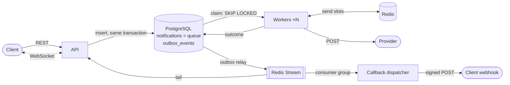
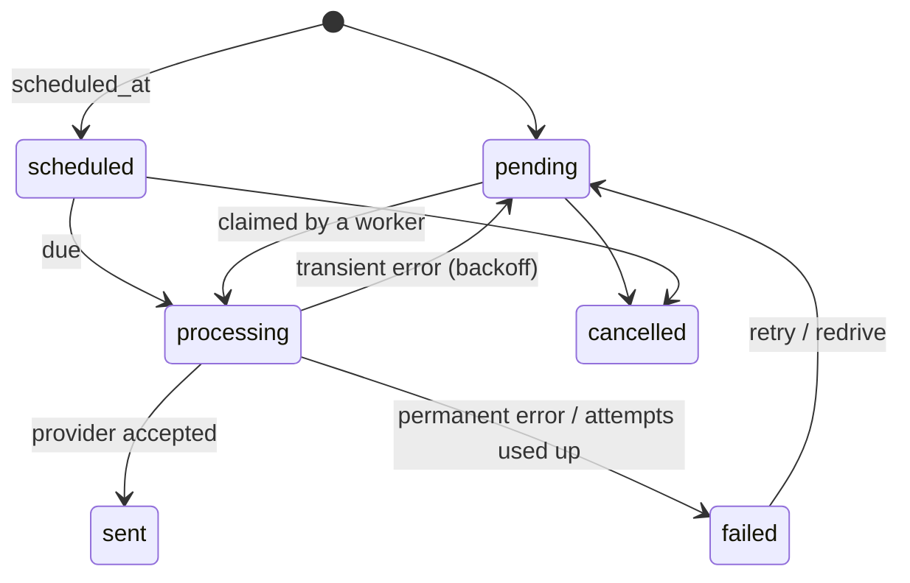

# Event-Driven Notification System

A notification service in Go that accepts SMS, email and push notifications
over a REST API, queues them, and delivers them asynchronously to an
external provider at no more than **100 messages per second per channel**,
highest priority first, with retries, a circuit breaker, a dead-letter
queue, live status over WebSocket and signed status callbacks.

```bash
docker compose up -d        # API, 2 workers, PostgreSQL, Redis, mock provider, Prometheus, Grafana, Jaeger
open http://localhost:8080/docs
```

---

- [Quick start](#quick-start)
- [What it does](#what-it-does)
- [Architecture](#architecture)
- [Design decisions](#design-decisions)
- [API tour](#api-tour)
- [Delivery guarantees](#delivery-guarantees)
- [Observability](#observability)
- [Testing](#testing)
- [Load test results](#load-test-results)
- [Configuration](#configuration)
- [Project layout](#project-layout)
- [Limitations and scaling further](#limitations-and-scaling-further)
- [How this was built](#how-this-was-built)

## Quick start

Requirements: Docker with Compose. Go 1.27 only to run the tests outside
Docker.

```bash
git clone https://github.com/tariktek/eventDrivenNotificationSystem.git
cd eventDrivenNotificationSystem
docker compose up -d        # first run builds the image: ~2 minutes
docker compose ps           # api, worker ×2 and mockprovider become "healthy"
```

| What | Where |
|---|---|
| API and Swagger UI (key: `dev-api-key-change-me`, use **Authorize**) | http://localhost:8080/docs |
| Live metrics (JSON) | http://localhost:8080/api/v1/metrics |
| Grafana dashboard (opens on it; anonymous view, `admin`/`admin` to edit) | http://localhost:3000 |
| Jaeger traces | http://localhost:16686 |
| Prometheus and alert rules | http://localhost:9090/alerts |
| Mock provider: what it received, fault injection | http://localhost:9000/admin/stats |

Send a notification and watch it go out:

```bash
curl -s localhost:8080/api/v1/notifications \
  -H 'X-API-Key: dev-api-key-change-me' -H 'Content-Type: application/json' \
  -d '{"channel":"sms","recipient":"+905551234567","content":"Your code is 4821","priority":"high"}'
# {"id":"01a1…","status":"pending",…}

curl -s localhost:8080/api/v1/notifications/<id> -H 'X-API-Key: dev-api-key-change-me'
# "status":"sent", "delivery_attempts":[{"attempt_no":1,"outcome":"success","status_code":202,…}]
```

**Using webhook.site as the provider.** The stack delivers to the bundled
mock provider by default (webhook.site's free tier caps requests, which
the load tests would exceed). To deliver to webhook.site instead, set the
URL and restart the workers:

```bash
echo 'PROVIDER_URL=https://webhook.site/<your-id>' > .env
docker compose up -d worker
```

Every request in [`examples/requests.http`](examples/requests.http) runs
with one click in VS Code (REST Client) or JetBrains IDEs.

## What it does

How each requirement of the assessment is met:

| Requirement | Implementation |
|---|---|
| Create a notification (recipient, channel, content, priority) | `POST /api/v1/notifications`; validated per channel: E.164 phones, SMS segment count (GSM-7/UCS-2, max 6), email subject required, size limits |
| Batch of up to 1,000 | `POST /api/v1/notifications/batch`: all-or-nothing validation, one transaction, ~200 ms for 1,000 |
| Status by notification or batch id | `GET /notifications/{id}` (with every delivery attempt), `GET /batches/{id}` (counts per status, progress), `GET /batches/{id}/notifications` |
| Cancel pending | `POST /notifications/{id}/cancel`, `POST /batches/{id}/cancel`; a race with a worker claiming it is resolved by the database (one of the two wins) |
| List with filters and pagination | `GET /notifications?status=&channel=&priority=&batch_id=&created_from=&created_to=`, cursor pagination (stable under inserts, fast at any depth) |
| Asynchronous processing with workers | PostgreSQL work queue (`FOR UPDATE SKIP LOCKED`), leases with heartbeats, a reaper for crashed workers; 2 worker replicas in compose |
| 100 messages/second per channel | A shared GCRA limiter in Redis hands out send slots 10 ms apart across all workers; local fallback if Redis is down. Verified from the receiving side under load |
| Priority (high, normal, low) | Claimed highest effective priority first; waiting work ages one level every 5 minutes so low priority never starves |
| Content validation | Per-channel rules above, plus strict JSON (unknown fields rejected), UTF-8 and NUL checks; every problem reported at once, by field path |
| Idempotency | `Idempotency-Key` header (Stripe-style replay of the original response) and a per-notification `idempotency_key` (duplicates in a batch are reported, not recreated) |
| Delivery and retry logic | Transient errors retried with exponential backoff and full jitter, `Retry-After` honoured; permanent errors fail at once; a per-channel circuit breaker pauses a failing channel without spending attempts; failed notifications form a dead-letter queue with single and bulk redrive |
| Metrics endpoint | `GET /api/v1/metrics`: queue depth per channel and priority, success and failure rates over 1/5/15 minutes, latency percentiles. Plus Prometheus at `/metrics` |
| Structured logging with correlation IDs | JSON logs; `X-Correlation-ID` is accepted or generated, stored with the notification and carried into the worker, the provider call and callbacks; personal data masked |
| Health check | `/health` (liveness) and `/ready` (dependencies, `degraded` when Redis is down or a breaker is open) |
| webhook.site as provider | `PROVIDER_URL` (one per channel possible); a fault-injecting mock provider is the default |
| **Bonus:** advanced failure handling | Circuit breaker, dead-letter queue, leases and reaper, graceful shutdown, Redis fallback, lossless event delivery through the outbox |
| **Bonus:** scheduled notifications | `scheduled_at`; cancellable until due |
| **Bonus:** templates | `/api/v1/templates`: versioned, variables extracted and validated, preview endpoint, sandboxed functions |
| **Bonus:** real-time status over WebSocket | `GET /api/v1/ws`: subscribe to notifications, batches, channels; ordered per notification; slow clients disconnected |
| **Bonus:** distributed tracing | OpenTelemetry to Jaeger: request, SQL, Redis and provider spans; the delivery trace links back to the request that created it |
| **Bonus:** CI/CD | GitHub Actions: lint, generated-code check, unit and integration tests, govulncheck, gitleaks, Trivy-scanned image pushed to GHCR, Dependabot |
| `docker-compose up`, OpenAPI, migrations, one-command tests | This page; [`api/openapi.yaml`](api/openapi.yaml) served at `/docs`; [`migrations/`](migrations) (versioned, up and down, applied by the `migrate` service); `make test` |

Beyond the brief: signed status callbacks, Grafana dashboard with alert
rules, k6 load tests, PII masking in logs.

## Architecture



1. The **API** validates a request and stores the notification. That row
   *is* the queue entry: nothing else to keep consistent.
2. **Workers** claim due notifications per channel, highest effective
   priority first, reserve send slots from the shared **rate limiter**,
   call the provider and record the outcome (sent, retry later, failed).
3. Every status change writes an **event to the outbox table** in the
   same transaction (a trigger). The **relay** publishes those events in
   order to a Redis Stream.
4. API instances tail the stream and push matching events to **WebSocket**
   clients; a consumer group turns final statuses into **signed callbacks**.

Diagrams of a notification's life, the state machine and the data model:
[`docs/architecture.md`](docs/architecture.md).

## Design decisions

Each has a short decision record in [`docs/adr/`](docs/adr):

| Decision | Why | Record |
|---|---|---|
| **PostgreSQL as the work queue**, not Kafka or RabbitMQ | The notification row and the queue entry are one thing: cancel, status queries, scheduling and retries are plain SQL, in transactions. `SKIP LOCKED` lets many workers claim without blocking each other. One less system to run | [001](docs/adr/001-postgres-work-queue.md) |
| **Transactional outbox** to Redis Streams | An event exists if and only if its change committed. Redis down means events wait, never lost | [002](docs/adr/002-transactional-outbox.md) |
| **GCRA rate limiter in Redis**, slots reserved after the claim | Exact spacing (10 ms) shared by all workers; reserving after the claim was a load-test finding (see below) | [003](docs/adr/003-rate-limiting.md) |
| **Retry with full jitter, per-channel circuit breaker** | Retries spread out instead of stampeding a recovering provider; an outage delays notifications instead of failing them | [004](docs/adr/004-retry-and-circuit-breaker.md) |
| **At-least-once delivery** | Exactly-once is impossible end to end without the provider's help; the duplicate window is narrowed and the provider gets an idempotency key | [005](docs/adr/005-at-least-once-delivery.md) |
| **Spec-first API** | `openapi.yaml` generates the server types; a handler cannot return an undocumented status, and contract tests check every response against the spec | [006](docs/adr/006-spec-first-api.md) |
| **Side effects owned by the relay** | Wake-ups and batch progress moved out of request transactions after the load tests showed them serializing every write | [007](docs/adr/007-relay-owned-side-effects.md) |

## API tour

All endpoints need `X-API-Key: dev-api-key-change-me`. Full reference:
http://localhost:8080/docs. Below, `$H` stands for
`-H 'X-API-Key: dev-api-key-change-me' -H 'Content-Type: application/json'`.

```bash
# A batch (all-or-nothing: one invalid item rejects the request, listing every problem)
curl -s localhost:8080/api/v1/notifications/batch $H -d '{
  "metadata": {"campaign": "black-friday"},
  "items": [
    {"channel": "sms",   "recipient": "+905551234567", "content": "50% off today only"},
    {"channel": "email", "recipient": "ada@example.com", "subject": "Sale", "content": "50% off today only"}
  ]}'
curl -s localhost:8080/api/v1/batches/<batch_id> $H           # counts per status, progress

# Safe retries of the request itself: same key → the original response, not a second batch
curl -s localhost:8080/api/v1/notifications $H -H 'Idempotency-Key: order-42' -d '{…}'

# Scheduled, with a callback when it reaches a final status
curl -s localhost:8080/api/v1/notifications $H -d '{"channel":"push","recipient":"device-token",
  "subject":"Reminder","content":"Your appointment is tomorrow","scheduled_at":"2026-12-01T09:00:00Z",
  "callback_url":"http://mockprovider:9000/callbacks"}'

# Templates
curl -s localhost:8080/api/v1/templates $H -d '{"name":"order-shipped","channel":"email",
  "subject":"Order {{.order_id}} has shipped","body":"Hi {{.name}}, order {{.order_id}} is on its way."}'
curl -s localhost:8080/api/v1/notifications $H -d '{"channel":"email","recipient":"ada@example.com",
  "template_id":"<id>","template_vars":{"name":"Ada","order_id":"A-1042"}}'

# List, filter, page
curl -s 'localhost:8080/api/v1/notifications?status=failed&channel=sms&limit=50' $H   # then &cursor=<next_cursor>

# Cancel; redrive the dead-letter queue after an outage (dry run first)
curl -s -X POST localhost:8080/api/v1/notifications/<id>/cancel $H
curl -s localhost:8080/api/v1/notifications/retry-failed $H -d '{"error_code":"http_503","dry_run":true}'

# Live events (any WebSocket client, e.g. websocat)
websocat 'ws://localhost:8080/api/v1/ws?channel=sms&api_key=dev-api-key-change-me'
```

**Callbacks** are `POST`s with `X-Signature: sha256=<hex HMAC-SHA256(secret,
timestamp + "." + body)>` and `X-Timestamp`. A receiver recomputes the
HMAC and rejects timestamps older than a few minutes (replay protection);
[`callback.Verify`](internal/callback/signature.go) is the reference
implementation, and the mock provider's `/callbacks` endpoint uses it
(received callbacks: http://localhost:9000/admin/callbacks).

## Delivery guarantees



- **At least once.** A worker that dies mid-delivery loses its lease; the
  reaper hands the notification to another worker. If the provider had
  already accepted it, it is sent again, with the same `X-Idempotency-Key`
  so the provider can drop the repeat.
- **Retries.** Transient failures (5xx, 429, timeouts, connection errors)
  retry after `random(0, min(2s · 2^attempt, 5m))`, or the provider's
  `Retry-After`, up to `max_attempts` (default 5, 1–10 per notification).
  Permanent errors (other 4xx) fail at once.
- **Outages.** When ≥50% of at least 20 deliveries in 10 s fail, the
  channel's breaker opens: nothing is claimed, so queued notifications
  keep their attempts. After 30 s a few probes test the provider.
- **Dead letters.** `failed` is the dead-letter state: listable, retried
  singly or in bulk by filter. [`docs/runbook.md`](docs/runbook.md) has
  the procedures.
- **Order.** Per channel, by effective priority, then due time. One
  notification's events reach WebSocket clients and callbacks in order.

## Observability

- **Metrics:** `GET /api/v1/metrics` (JSON, system-wide, sampled from the
  database every 5 s) and Prometheus `/metrics` on the API and each worker:
  throughput, failures by reason, retries, queue depth and age, delivery and
  provider latency, rate-limit waits, breaker state, outbox lag, callbacks,
  HTTP traffic.
- **Dashboard and alerts:** the Grafana dashboard (provisioned) shows them
  live; Prometheus alerts on a stale backlog, a failure rate over 10%, a
  breaker open over 2 minutes, outbox lag and limiter fallback.
- **Logs:** JSON with `correlation_id`, `trace_id`, `span_id`; phone
  numbers and emails masked in every record.
- **Traces:** an API request, its SQL, and later each delivery attempt
  (linked to the request that created it), with the provider call and
  the outcome's SQL. Only units of work start traces, so background polling
  does not bury them.

## Testing

```bash
make test        # everything: unit, integration, end-to-end (needs Docker; real PostgreSQL and Redis via testcontainers)
make test-unit   # no Docker, seconds
make test-e2e    # API + worker + relay + WebSocket + callbacks in one process
make test-fuzz   # input parsers
make test-load   # k6 against the running stack
make cover       # coverage report
```

Without `make` (e.g. Windows PowerShell): `go test -count=1 -p 1 -tags=integration ./...`

| Layer | What it proves |
|---|---|
| Unit | Validation tables, SMS segmenting, state machine, backoff, error classification, templates, HMAC, SSRF filter, breaker, rate limiter math |
| Contract | Every API response matches the OpenAPI spec; every example in the spec matches its schema |
| Integration | SQL against real PostgreSQL: concurrent claims never take a row twice, cancel vs claim races, idempotency under concurrency, migrations up and down; the Redis limiter never exceeds its rate |
| Worker | Priority order, retries, permanent failures, the breaker keeping attempts, crash recovery, graceful shutdown, slow claims not bursting past the limit, chaos (two workers, 30% random faults, one stopped midway: everything delivered exactly once) |
| End-to-end | A batch watched over WebSocket (every change, in order) with verified callbacks; scheduled sends; retry chains; batch cancel; callback retries |
| Fuzz | Request validation, SMS analysis, templates, pagination cursors never panic |

Coverage of the core packages: domain 96%, worker 90%, validation 94%,
rate limiter 98%, service 83% (all tests: `make cover`).

## Load test results

k6 against the compose stack on a laptop (details and the scenarios:
[`loadtest/README.md`](loadtest/README.md)):

| Scenario | Result |
|---|---|
| 150 creates/s for 2 minutes | p50 **24 ms**, p95 **70 ms**, p99 **122 ms** |
| Flash sale: 50,000 in 60 s | Batches accepted in p99 393 ms; all delivered in **188 s** (~90/s per channel at a 100/s limit); busiest second **101–103**; 0 lost, 0 duplicated |
| Provider failing 25% of calls | 5,993 of 5,998 delivered after 1,879 retries; 5 dead-lettered (expected ≈ 6) |

The first runs failed, and fixing them improved the design: a NOTIFY in
every write serialized the API (p50 855 ms → 27 ms), slots reserved
before slow claims went stale and burst to **175/s** (now 101–103), and a
per-batch row lock capped delivery at ~52/s per channel (now ~90/s).
Each has a regression test; [ADR 007](docs/adr/007-relay-owned-side-effects.md)
records the change.

## Configuration

Environment variables, validated at startup (all errors reported at once;
production refuses development secrets). Defaults suit local development;
[`.env.example`](.env.example) documents each.

| Group | Variables (default) |
|---|---|
| General | `APP_ENV` (development), `SHUTDOWN_TIMEOUT` (20s), `LOG_LEVEL` (info), `LOG_FORMAT` (json) |
| HTTP | `HTTP_ADDR` (:8080), `HTTP_READ_HEADER_TIMEOUT` (5s), `HTTP_READ_TIMEOUT` (15s), `HTTP_WRITE_TIMEOUT` (15s), `HTTP_IDLE_TIMEOUT` (60s), `HTTP_MAX_BODY_BYTES` (5 MiB) |
| Auth | `API_KEYS` (comma-separated; dev key), `IDEMPOTENCY_TTL` (24h) |
| Storage | `DATABASE_URL`, `DATABASE_MAX_CONNS` (20), `DATABASE_MIN_CONNS` (2), `REDIS_URL` |
| Provider | `PROVIDER_URL` (mock), `PROVIDER_URL_SMS` / `_EMAIL` / `_PUSH` (per-channel overrides), `PROVIDER_TIMEOUT` (10s) |
| Worker | `WORKER_RATE_LIMIT` (100/s per channel), `WORKER_RATE_HORIZON` (1s), `WORKER_CONCURRENCY` (100), `WORKER_BATCH_SIZE` (50), `WORKER_POLL_INTERVAL` (1s), `WORKER_LEASE` (30s), `WORKER_REAP_INTERVAL` (10s), `WORKER_PRIORITY_AGING` (5m), `WORKER_EXPECTED_INSTANCES` (1), `WORKER_ID` |
| Retry and breaker | `RETRY_BASE_DELAY` (2s), `RETRY_MAX_DELAY` (5m), `BREAKER_WINDOW` (10s), `BREAKER_MIN_REQUESTS` (20), `BREAKER_FAILURE_RATIO` (0.5), `BREAKER_OPEN_TIMEOUT` (30s), `BREAKER_PROBES` (5) |
| Events | `EVENTS_STREAM`, `EVENTS_STREAM_MAX_LEN` (100,000), `OUTBOX_BATCH_SIZE` (500), `OUTBOX_POLL_INTERVAL` (100ms), `OUTBOX_RETENTION` (24h), `OUTBOX_PRUNE_INTERVAL` (10m) |
| Callbacks | `CALLBACK_SIGNING_SECRET`, `CALLBACK_TIMEOUT` (5s), `CALLBACK_MAX_ATTEMPTS` (5), `CALLBACK_CONCURRENCY` (20), `CALLBACK_RETRY_BASE_DELAY` (5s), `CALLBACK_RETRY_MAX_DELAY` (10m), `CALLBACK_LEASE` (1m), `CALLBACK_POLL_INTERVAL` (1s), `CALLBACK_ALLOW_INSECURE` / `_PRIVATE` (false; development only) |
| WebSocket | `WS_MAX_CLIENTS` (1000), `WS_BUFFER_SIZE` (256), `WS_ALLOWED_ORIGINS` |
| Tracing | `TRACING_ENABLED` (false; true in compose), `TRACING_ENDPOINT`, `TRACING_SAMPLE_RATIO` (1) |

## Project layout

```
api/openapi.yaml          the API contract; server types are generated from it
cmd/                      api, worker, mockprovider, healthcheck (distroless has no curl)
internal/
  domain/                 notification, batch, template, status machine: no I/O
  validation/ msgtemplate/  input rules, SMS segmenting, sandboxed templates
  service/                use cases behind the API
  http/                   router, middleware (auth, idempotency, correlation, tracing, metrics), handlers
  repository/postgres/    SQL (sqlc) and the work queue
  worker/ ratelimit/ breaker/ retry/ provider/   the delivery pipeline
  outbox/ events/ realtime/ callback/            events: relay, Redis Streams, WebSocket, callbacks
  metrics/ stats/ observability/                 Prometheus, the JSON summary, logging and tracing
migrations/               versioned schema (golang-migrate)
test/e2e/                 the whole system in one process
loadtest/                 k6 scenarios and results
deploy/                   Prometheus, alert rules, Grafana provisioning
docs/                     architecture, decision records, runbook, security
```

## Limitations and scaling further

Known limits and the accepted security risks are in
[`docs/security.md`](docs/security.md). How this would grow:

- **10× traffic.** The ceiling is write throughput of one PostgreSQL
  primary (each notification is a few short transactions). Next steps, in
  order: partition `notifications` by time (cheap retention: drop a
  partition), separate queue tables per channel, then move hot queues to a
  log (Kafka/Redpanda) while keeping PostgreSQL as the system of record.
- **Rate limits per tenant.** The limiter already takes a key; per-client
  quotas are a new key scheme plus configuration.
- **Fairness inside a priority.** One huge batch delays later messages of
  the same priority (FIFO within a level). Fair queuing between batches
  would fix it.
- **Exactly-once.** Only with provider-side deduplication on the
  idempotency key this service already sends.
- **Multi-region.** A queue per region with a regional provider endpoint;
  the outbox pattern carries events across regions.

## How this was built

This project was built with an AI coding assistant as a pair programmer,
which is how I work. The assistant wrote most of the code; the
architecture, the plan ([`docs/ROADMAP.md`](docs/ROADMAP.md)), the
trade-offs and every commit went through me. What made the result
trustworthy was verification rather than generation: tests at every
layer, contract tests against the spec, code reviews at the end of each
phase, and load tests that measured the system from the receiving side.

That process caught real problems, several of them introduced by
generated code: a race that dropped events when a stream reader started,
a lenient JSON decoder that would have let a misspelled filter redrive
every failed notification, a write-timeout context that cut off WebSocket
close handshakes at shutdown, a truncation that split UTF-8 characters
and made callbacks retry forever, and the three performance problems the
load tests exposed. Each was diagnosed to its root cause and has a test
that fails without the fix.
