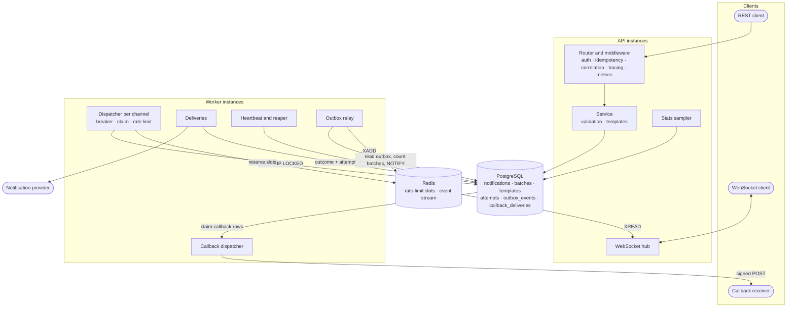
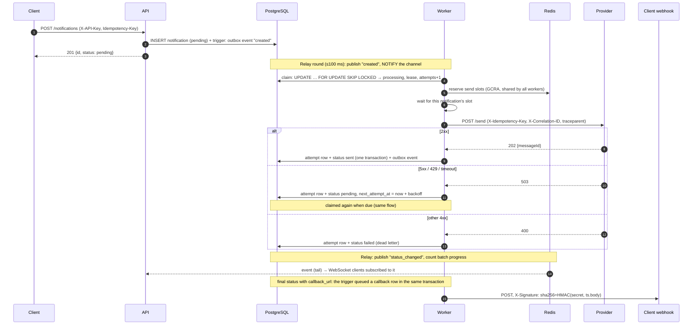

# Architecture

## Components

| Component | Runs in | Does |
|---|---|---|
| Router and middleware | API | Correlation ID, request log, panic recovery, security headers, tracing, metrics, then for `/api/v1`: API key, body limit, `Idempotency-Key` |
| Service | API | Validates, renders templates, writes notifications (and batches) in one transaction |
| WebSocket hub | API | Tails the event stream, pushes matching events to subscribed clients |
| Stats sampler | API | Every 5 s: queue depth, delivery windows, latency percentiles, outbox lag, from the database |
| Dispatcher | Worker, one per channel | Breaker check → claim → reserve send slots → start deliveries |
| Delivery | Worker | Waits for its slot, calls the provider, records the outcome and the attempt in one transaction |
| Heartbeat, reaper | Worker | Extends leases of in-flight deliveries; requeues work of workers that stopped heartbeating |
| Outbox relay | Worker (one at a time) | Publishes outbox events to the stream in order, counts batch progress, wakes workers |
| Callback dispatcher | Worker | Sends the callback rows the outbox trigger queues with each final status, signed, one notification's in order, with retries |

## The life of a notification

Points to note:

- **Steps 2–3:** the response is sent once the row is committed. Delivery
  is asynchronous; the client follows it by polling, WebSocket or callback.
- **Step 5:** `SKIP LOCKED` lets many workers claim concurrently without
  waiting on each other's rows; the lease (`locked_until`) is extended by
  the heartbeat while the delivery runs, and a reaper requeues it if the
  worker dies.
- **Step 6:** slots are reserved *after* the claim, so a slow claim cannot
  leave them in the past (which would release a burst above the limit).
- **Step 9:** the attempt row and the status change are one transaction:
  the history never disagrees with the status.
- **Events:** produced by a trigger in the same transaction as the change,
  published by a single relay at a time, so one notification's events are
  always in order.

## Priority and fairness

Workers claim per channel, ordered by **effective priority**:
`priority − floor(wait / WORKER_PRIORITY_AGING)` (floored at high), then by
due time. A low-priority notification waiting 10 minutes competes as high,
so a stream of high-priority traffic cannot starve it. The claim reads the
top candidates of each priority level from the partial queue index and
picks among them, so it stays an index scan at any backlog (~11 ms over
200,000 queued rows).

## State machine

| From | To | When |
|---|---|---|
| (new) | `pending` | Created without `scheduled_at` |
| (new) | `scheduled` | Created with a future `scheduled_at` |
| `pending`, `scheduled` | `processing` | Claimed by a worker (scheduled ones once due) |
| `processing` | `sent` | Provider accepted it |
| `processing` | `pending` | Transient error (retry after backoff), or handed back at shutdown or by the breaker (attempt refunded) |
| `processing` | `failed` | Permanent error, attempts used up, or the lease expired with no attempts left |
| `pending`, `scheduled` | `cancelled` | Cancelled by the client |
| `failed` | `pending` | Retried manually (single or bulk), with a fresh attempt budget |

Every transition is a conditional `UPDATE` (`WHERE status = …`), so races
(a cancel against a claim, two workers against one lease) have exactly one
winner. CHECK constraints enforce the invariants (a `sent` row has
`sent_at`, a `processing` row has a lease, an email has a subject).

## Data model

| Table | Holds |
|---|---|
| `notifications` | Everything about a notification, and the queue: `status`, `priority`, `next_attempt_at`, lease (`locked_by`, `locked_until`). Partial index on due work; indexes for listing and statistics |
| `notification_attempts` | One row per delivery attempt: outcome, status code, error, duration |
| `batches` | Batch metadata and progress (`created_count`, `finished_count`, `completed_at`) |
| `templates` | Versioned templates and their variables |
| `idempotency_keys` | Request-level idempotency: request hash, stored response, lock token |
| `outbox_events` | Domain events awaiting (or past) publication |
| `callback_deliveries` | Status callbacks and their retry state |

Migrations: [`migrations/`](../migrations), versioned and reversible,
applied by the `migrate` service on `docker compose up`.

## Events

| Event | When | Payload |
|---|---|---|
| `notification.created` | Insert | id, batch, channel, priority, status, schedule |
| `notification.status_changed` | Any status change | the same, plus previous status, attempts, error code, provider message id |
| `batch.completed` | The last item of a batch reached a final status | counts per status |

Payloads carry state, never recipients or content: they reach WebSocket
clients and logs. Callback bodies wrap the event: `{event_id, type
(notification.sent / .failed / .cancelled), occurred_at, data}`.

## Failure handling

| Failure | Behaviour |
|---|---|
| Worker crashes mid-delivery | Lease expires; the reaper requeues the notification (attempt counted: the provider may have received it) |
| Worker stops (deploy) | Stops claiming, lets started deliveries finish within the grace period, hands back the rest with their attempt refunded |
| Provider down | Breaker opens per channel after ≥50% failures over ≥20 deliveries; nothing is claimed; probes after 30 s |
| Provider slow | Bounded by `PROVIDER_TIMEOUT`; slots keep pacing; leases are extended by the heartbeat |
| Redis down | Rate limiting falls back to a local limiter (rate ÷ expected instances); events wait in the outbox and are published, in order, once Redis returns; callbacks keep going (they are queued in PostgreSQL); readiness reports `degraded` |
| PostgreSQL down | API returns 500 and readiness reports `down`; workers retry claims; nothing is lost because nothing was accepted |
| Relay crashes after publishing | The next round publishes the same events again; the WebSocket hub drops repeats by event id; batch progress is counted in the relay's transaction, so exactly once |
| Callback receiver down | Retried with backoff up to `CALLBACK_MAX_ATTEMPTS`, then `failed` |
